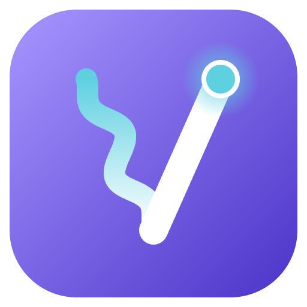
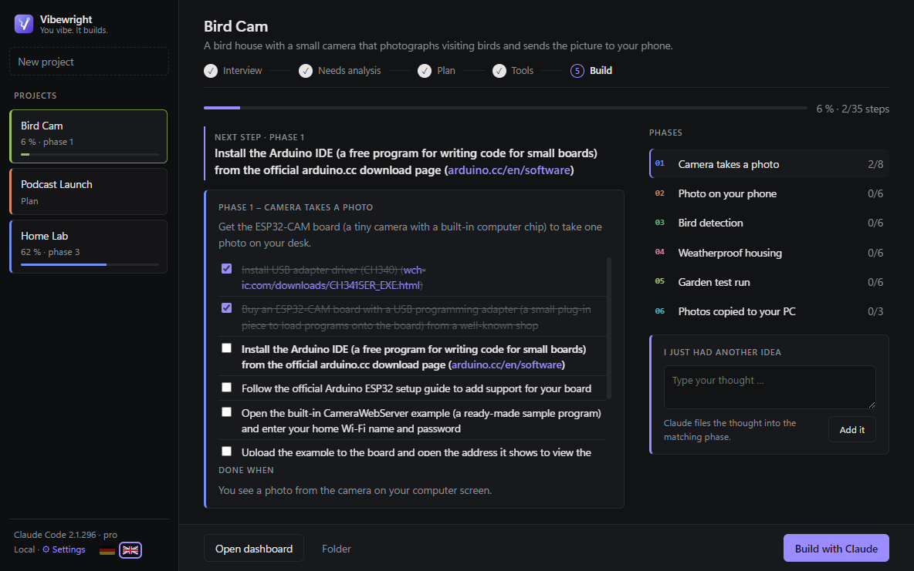
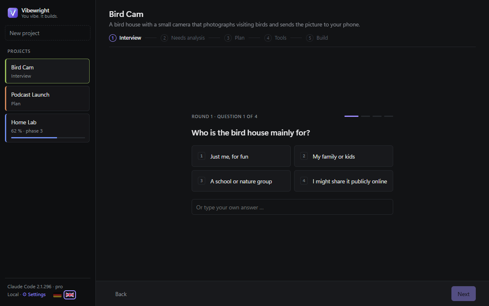
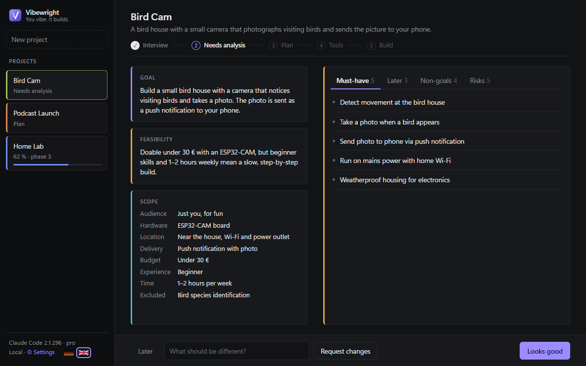
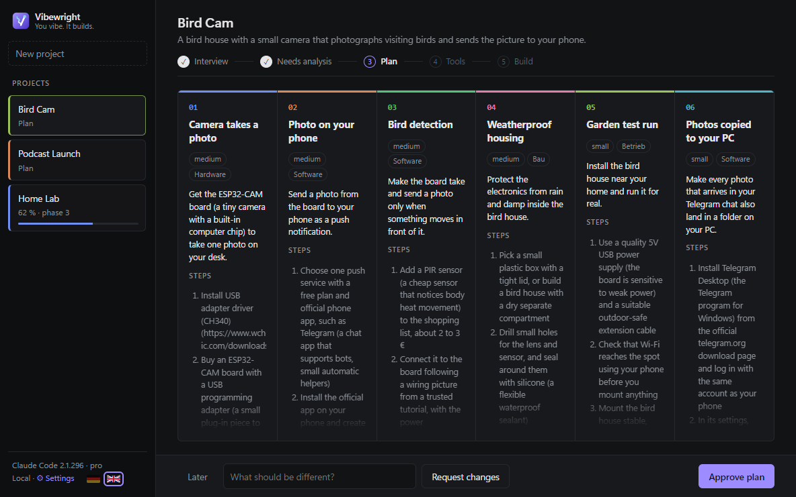
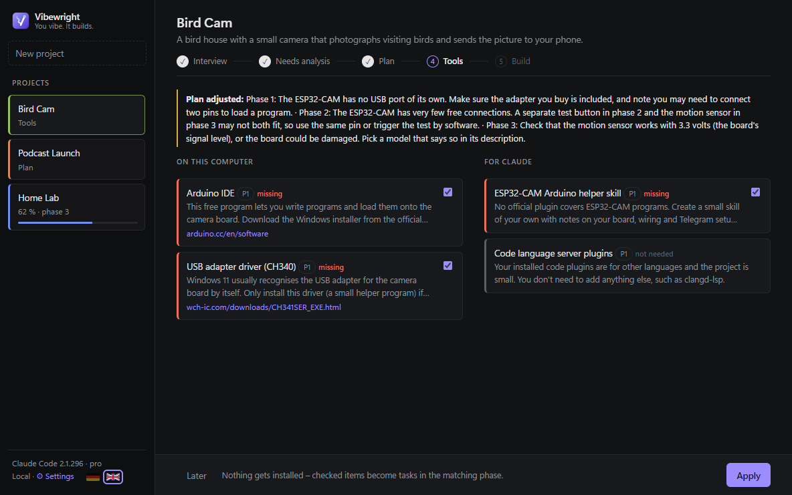
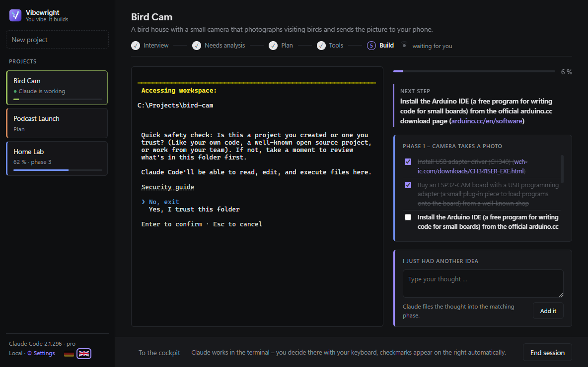
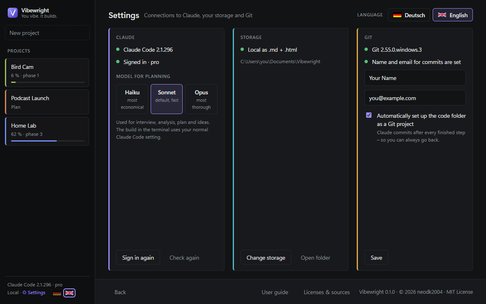
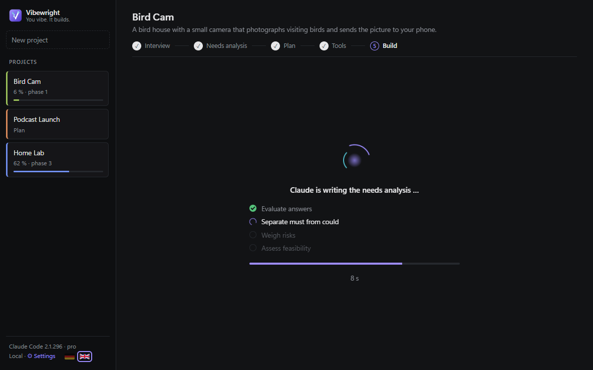
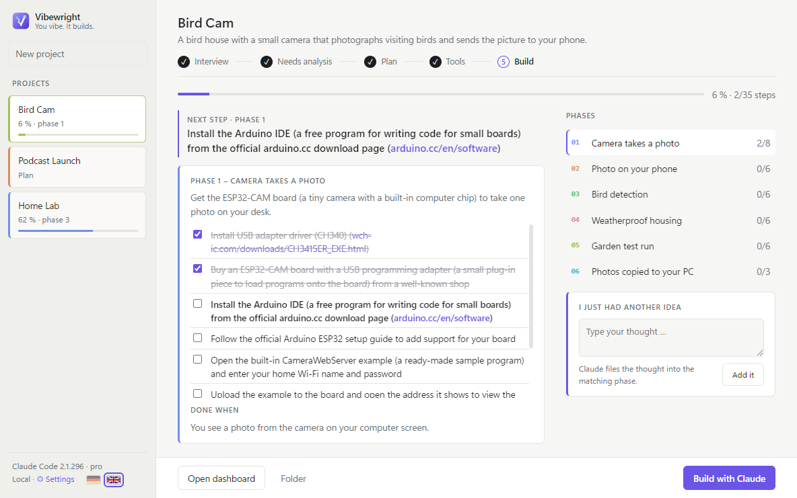

<p align="center">
  
</p>

<h1 align="center">Vibewright</h1>
<p align="center"><b>You vibe. It builds.</b><br>
Turn a one-line idea into a complete project roadmap – and build it with Claude Code, right inside the app.</p>

<p align="center">
  
  
  
  
  <a href="https://github.com/neodk2004/vibewright/releases/latest"></a>
</p>

<p align="center"><a href="https://ko-fi.com/E8R028M0YO"></a></p>

<p align="center"></p>

---

## What is Vibewright?

You have an idea. Maybe a bird house camera, a podcast, a home server. Getting from *"I'd like to…"* to *"it works"* usually means juggling chats, notes, half-finished plans and forgotten next steps.

Vibewright is a desktop app for Windows and macOS that does the project management for you. You type one sentence; Vibewright interviews you, writes a needs analysis, cuts the goal into phases, checks which tools you and Claude need – and then lets you build it step by step with **Claude Code running inside the app**. You stay the decision maker: you click, approve and tick off. Claude does the heavy lifting in the background.

```
Idea ──► Interview ──► Needs analysis ──► Plan ──► Tool check ──► Build
          (clicks)      🚦 approve        🚦 approve  🚦 approve     Claude Code in the app
```

## Features

- **Guided interview** – one multiple-choice question per screen (keys 1–4), with your own answer as an option. Two short rounds, follow-up questions only where answers leave gaps.
- **Needs analysis** – goal, scope, must-have / could-have / non-goals, risks you didn't think of, and a feasibility traffic light.
- **Plan as a roadmap** – 3–6 phases with goals, "done when" criteria and concrete steps in plain language (no unexplained commands).
- **Tool check** – inspects your PC and your Claude setup (plugins, skills, MCP servers, operating system) and recommends only what a phase really needs, from official sources. Nothing gets installed without your OK.
- **Cockpit** – the current phase with its checklist, progress, next step and all phases at a glance.
- **Claude Code inside the app** – an embedded terminal runs Claude Code with a generated `CLAUDE.md` that knows your project, phase and next step. Claude ticks off finished steps; the checklist updates live.
- **"I just had another idea"** – type a thought any time; Claude sorts it into the right phase (or creates a new one). While Claude is working, the idea waits until the current step is done.
- **Your notes, your format** – everything is written as Markdown into your **Obsidian** vault (with Dataview tables and Kanban if you use them) or locally as `.md` + an `.html` dashboard.
- **Git safety net (optional)** – the code folder becomes a Git project and Claude commits after every finished step, so you can always go back.
- **English & German** – UI, Claude's texts and the generated files. The language is fixed per project.
- **Easy on your limits** – planning calls run Claude Code headless without tools and with a short system prompt (~1,000 input tokens per call instead of ~15,000–20,000).

## Screenshots

| Interview | Needs analysis |
|---|---|
|  |  |
| **Plan** | **Tool check** |
|  |  |
| **Claude Code inside the app** | **Settings** |
|  |  |
| **While Claude thinks** | **Light mode** |
|  |  |

## Documentation

- 📖 [Wiki manual (English)](https://github.com/neodk2004/vibewright/wiki/Home-English) · [Handbuch (Deutsch)](https://github.com/neodk2004/vibewright/wiki) – one page per chapter, with screenshots
- 📘 [User guide](docs/user-guide.md) – everything from the first start to a finished project
- 📗 [Anleitung (Deutsch)](docs/anleitung.md)
- 🛠️ [Developer guide](docs/developer-guide.md) – architecture, Claude calls, tests, building
- 📜 [Third-party notices](THIRD_PARTY_NOTICES.md) – all libraries and tools with versions and licenses
- 🤝 [Contributing](CONTRIBUTING.md) · [Code of Conduct](CODE_OF_CONDUCT.md) · [Security policy](SECURITY.md)

## Requirements

| | |
|---|---|
| **Windows 10 or 11** (64-bit) **or macOS 11 Big Sur or later** | Mac: Apple Silicon (M1–M4) and Intel are both supported |
| **Claude Code** | installed and signed in – [official setup guide](https://docs.claude.com/en/docs/claude-code/setup). Native installer and npm installation are both supported. |
| **Claude subscription** | Pro or Max recommended. Signing in with an API key works too, but then every call is billed separately. |
| Obsidian *(optional)* | [obsidian.md](https://obsidian.md) – with the community plugins *Dataview* and *Kanban* for live tables and a project board. Without Obsidian, Vibewright saves `.md` files plus an `.html` dashboard. |
| Git *(optional)* | [git-scm.com](https://git-scm.com/downloads) – for the automatic commit-per-step safety net. |

## Installation

### Windows

1. Download **`Vibewright.Setup.x.y.z.exe`** from the [Releases](../../releases) page.
   *Optional but recommended:* [verify the download](#verify-your-download).
2. Run it and choose an installation folder.
   > The installer is not code-signed yet, so Windows SmartScreen may warn you. Click **More info → Run anyway**.
3. Start Vibewright. On first launch it checks Claude Code, lets you sign in and asks where your projects should live.

### macOS

1. Download the file for your Mac from the [latest release](../../releases/latest):
   - **Apple Silicon** (M1, M2, M3, M4 …): `Vibewright-x.y.z-mac-arm64.dmg`
   - **Intel**: `Vibewright-x.y.z-mac-x64.dmg`

   Not sure? Apple menu → *About This Mac* → "Chip" (Apple M…) or "Processor" (Intel).
2. Open the `.dmg` and drag **Vibewright** into **Applications**.
3. Start Vibewright from *Applications*. The app is **signed with an Apple Developer ID and notarized by Apple**, so macOS opens it without warnings.

### Verify your download

Every release lists the **SHA-256 checksum** of the installer in its release notes and in an attached `SHA256SUMS.txt` (GitHub also shows it next to the file). Inside your download folder:

```powershell
# Windows (PowerShell)
(Get-FileHash .\Vibewright.Setup.0.2.2.exe -Algorithm SHA256).Hash
```

```bash
# macOS (Terminal)
shasum -a 256 Vibewright-0.2.2-mac-arm64.dmg
```

If the output matches the published value, your file is exactly the released one.

Every installer is also **scanned by VirusTotal** (around 70 antivirus engines) with the public workflow [`.github/workflows/virustotal.yml`](.github/workflows/virustotal.yml). The result and a link to the full report are added to the release notes; the badge at the top shows the latest result. Prefer to check the code yourself? [Run from source](#run-from-source) or build the installer with `npm run exe`.

### Run from source

```bash
git clone https://github.com/neodk2004/vibewright.git
cd vibewright/app
npm install
npm start            # starts the app
npm test             # end-to-end test with real Claude calls (uses a bit of your limit)
npm run exe          # builds the Windows installer into app/dist/
npm run exe:mac      # builds the Mac app (on a Mac) into app/dist/
```

## What's new

<!-- changelog:start -->
<!-- Generated from CHANGELOG.md – do not edit here. -->
### [0.2.2](https://github.com/neodk2004/vibewright/releases/tag/v0.2.2) – 2026-10-26

#### Added
- **Tool check – more sources:** besides the official catalog, Vibewright now uses every plugin marketplace you have added to Claude Code and the [claude-skills](https://github.com/alirezarezvani/claude-skills) catalog (even if you have not added it yet).
- **Tool check – ready-made skills from [SkillsMP](https://skillsmp.com):** if no catalog fits, Vibewright searches SkillsMP. Only Claude-compatible skills from GitHub repositories with at least 50,000 stars are considered, and Claude picks one only if it really fits. SkillsMP only receives 1–3 English keywords, never your idea or plan.
- **Tool check – link check:** suggested download pages are opened once; dead links are replaced with the maker's current page or marked with ⚠.
- **Windows installer in the Vibewright look:** welcome page with the Vibewright sidebar, logo header on every page, German or English depending on your Windows language.

#### Changed
- The tool check now also counts skills inside installed plugins and skills in the project's code folder as available, and notices switched-off plugins.

### [0.2.1](https://github.com/neodk2004/vibewright/releases/tag/v0.2.1) – 2026-10-26

#### Added
- **Update notice:** once per start, Vibewright checks GitHub for a newer release and shows a green notice at the bottom left that opens the download page. No project data is sent.
- **Warning for storage inside a program folder:** if your vault or storage folder lies inside an app's installation folder (for example a vault inside the Obsidian program folder), Vibewright warns you – an update or reinstall of that app deletes the folder with everything in it. Such vaults are also marked when you choose your storage.

#### Fixed
- **Missing storage folder:** if the storage folder was moved, deleted or its drive is not connected, Vibewright now says so clearly (with "Choose another storage" and "Check again") instead of silently showing an empty project list.
- One damaged project file no longer hides all other projects from the list.

### [0.2.0](https://github.com/neodk2004/vibewright/releases/tag/v0.2.0) – 2026-10-12

#### Added
- **Archive projects:** packs a project into a ZIP file in the `Archiv` folder of your storage and removes it from the list. File names with umlauts stay intact on Windows and macOS.
- **Delete projects:** shows a clear warning first; the next confirmation removes the project for good. Your own code folder is never touched.
- Both actions are in the header of every project. Archiving or deleting also removes the project's line from the Obsidian kanban board and ends a running Claude session for that project.
- Windows and macOS (Apple Silicon + Intel) now ship together in one release.

[Full changelog](CHANGELOG.md)
<!-- changelog:end -->

## How it works

```
┌──────────── Vibewright (Electron) ────────────┐
│  UI ──► core.js (state machine, files)        │
│           │                                   │
│           ├─► claude -p --json-schema …        │  planning: headless, no tools,
│           │     (structured JSON answers)     │  own short system prompt
│           │                                   │
│           └─► node-pty ──► claude (interactive)│  building: embedded terminal
│                    ▲            │             │  (xterm.js)
│                    └─ CLAUDE.md ┘             │
└──────────────┬───────────────────────────────┘
               ▼
   Your vault / folder: Dashboard · Tasks · Plan · Needs analysis · Tool check
```

- Claude only returns **structured JSON**; Vibewright writes all files itself – Claude never needs write access for planning.
- Progress lives in the **task files**. Whether you tick a box in Vibewright, in Obsidian, or Claude ticks it while building – the app reads it back and updates progress, next step and dashboard.
- Each project keeps its state in `projekthelper-state.json`, so you can pause for weeks and pick up exactly where you left off.

## Privacy

- Vibewright itself sends **no telemetry** and stores its settings only on your PC (`%APPDATA%`).
- **Tool check:** while checking tools, Vibewright fetches the [claude-skills](https://github.com/alirezarezvani/claude-skills) plugin catalog from GitHub, sends 1–3 English keywords per missing skill to the [SkillsMP](https://skillsmp.com) search (never your idea or plan text), reads candidate `SKILL.md` files from GitHub and opens the suggested download pages once to check they exist.
- **Update check:** once per start, Vibewright asks the public GitHub API for the newest release (`api.github.com/repos/neodk2004/vibewright/releases/latest`). No project data is sent – GitHub only sees an ordinary web request.
- What you plan with Claude (your idea, answers, plan, a list of installed Claude plugins/skills and your operating system for the tool check) is sent to Anthropic through Claude Code – exactly like any other Claude Code usage.
- If you push a project to GitHub, the Git commits contain the name and email from your Git config. Use GitHub's `noreply` address if you don't want your email to be public.

## Project structure

```
app/
  main.js        Electron main process: windows, settings, embedded terminal (node-pty)
  core.js        Planning flow, Claude calls, file generation, progress
  renderer.js    User interface
  i18n.js        English UI layer
  style.css      Design, animations, compact mode for small screens
  splash.html    Splash screen
  assets/        Runtime icons
  build/         Icon source (icon.svg) and build resources
  test/          End-to-end and installation tests
docs/            README images
```

## Deutsch

Vibewright macht aus einer einzeiligen Idee eine fertige Laufkarte: Interview → Bedarfsanalyse → Plan → Werkzeug-Check → Umsetzung. Umgesetzt wird mit Claude Code direkt in der App, du entscheidest nur noch an den Freigaben. Die Ablage erfolgt in Obsidian oder lokal als Markdown. Die Oberfläche lässt sich in der Seitenleiste oder in den Einstellungen per Flagge zwischen Deutsch und Englisch umschalten. Voraussetzungen und Installation: siehe oben.

## Built with

Vibewright stands on the shoulders of a few open-source projects – [Electron](https://www.electronjs.org), [xterm.js](https://xtermjs.org) and [node-pty](https://github.com/microsoft/node-pty) (via [@lydell/node-pty](https://github.com/lydell/node-pty)) – all MIT-licensed. Full details, versions and license texts: [THIRD_PARTY_NOTICES.md](THIRD_PARTY_NOTICES.md).

Vibewright was developed with the help of **Claude Code**. All code was reviewed and tested and is published by the author under the MIT license.

## Disclaimer

Vibewright is an independent open-source project and is **not affiliated with, endorsed by or sponsored by Anthropic**. *Claude* and *Claude Code* are trademarks of Anthropic, PBC. Vibewright simply uses the Claude Code CLI that you install and sign in to yourself.

## License

[MIT](LICENSE) © 2026 [neodk2004](https://github.com/neodk2004)
